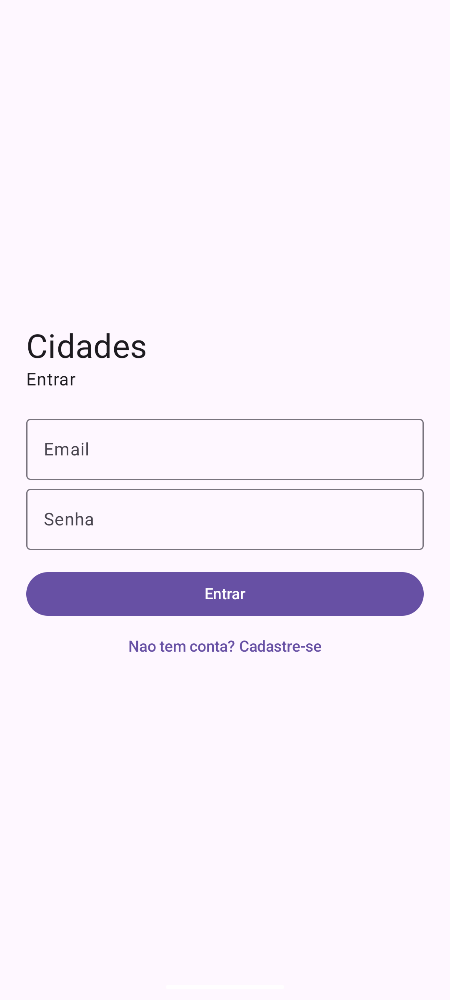
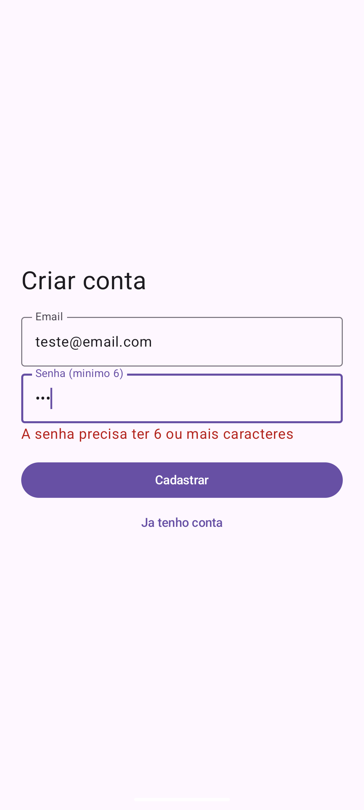
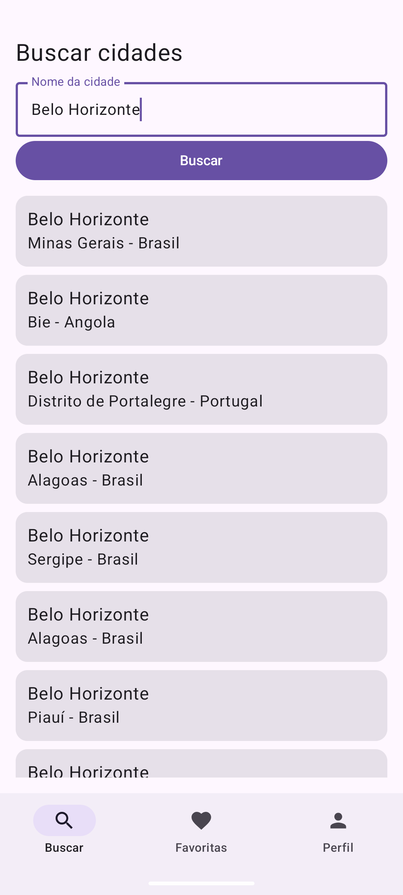
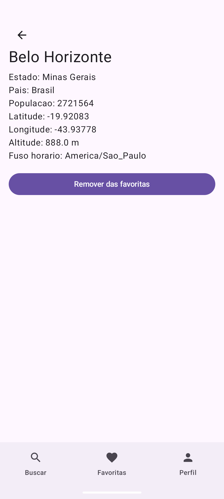
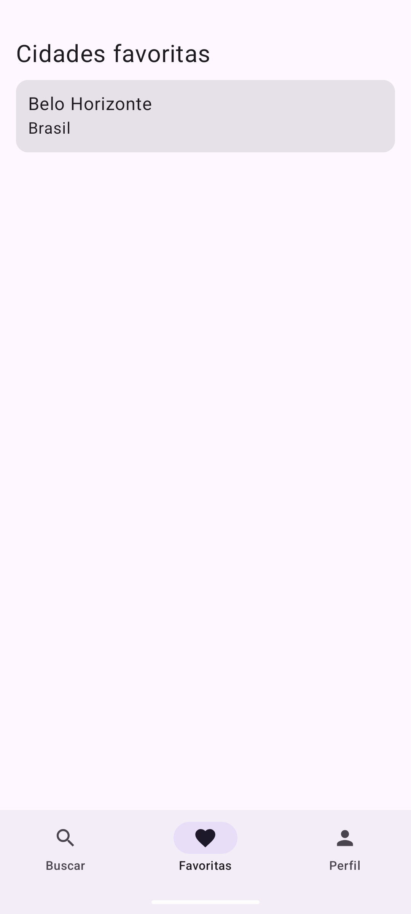
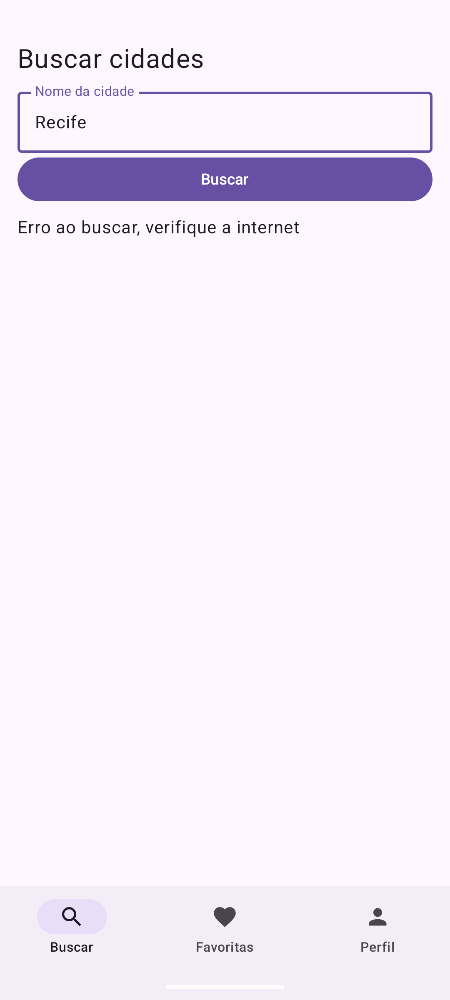

# Cidades

App pra buscar cidades do mundo todo, ver os dados de cada uma e salvar as favoritas na sua conta.

## API utilizada

Open-Meteo Geocoding API - https://geocoding-api.open-meteo.com/v1/

Usamos duas rotas dela:
- `search?name=...` pra buscar as cidades pelo nome (lista)
- `get?id=...` pra pegar os dados de uma cidade pelo id (tela de detalhe)

Nao precisa de cadastro nem de chave.

## Prints

| Login | Cadastro | Lista |
|-------|----------|-------|
|  |  |  |

| Detalhe | Favoritas | Erro (modo aviao) |
|---------|-----------|-------------------|
|  |  |  |

## Divisao de tarefas

| Integrante | O que fez |
|------------|-----------|
| Bernardo Iannini | Codigo do app: network, data (Room, usuarios, favoritas, Repository), viewmodel e telas/navegacao |
| Jose Augusto | Prototipo das telas no Figma |

## O que aprendemos

- Bernardo Iannini: aprendi a juntar Retrofit, Room e navegacao num app so, deixando cada coisa no seu pacote.
- Jose Augusto: aprendi a planejar as telas e o fluxo do app antes de comecar a programar.

## Como rodar

1. Abrir a pasta do projeto no Android Studio
2. Esperar o gradle sincronizar
3. Rodar no emulador ou no celular (precisa de internet pra buscar as cidades)

## Organizacao

```
com.bernardojose.cidades
 ├─ network        CidadeApi (retrofit) e RetrofitInstancia
 ├─ data           Cidade, Usuario, Favorita, os Dao, BancoDados, CidadeRepository e o sha256
 ├─ viewmodel      CidadesViewModel e os estados (EstadoBusca, EstadoDetalhe)
 └─ userinterface  MainActivity, rotas, navegacao e as telas
```
